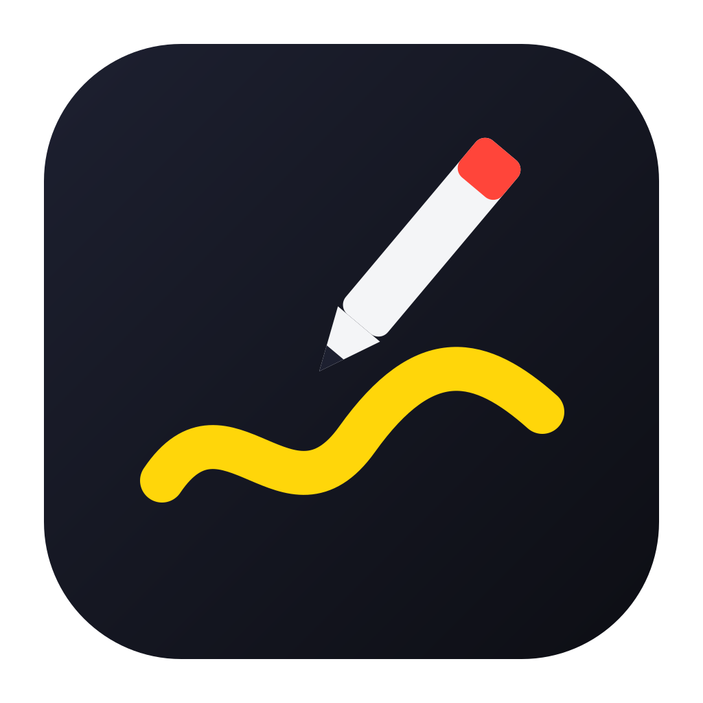

# ratelpen

[English](README.md) · 한국어

[](https://github.com/likeratel/ratelpen/actions/workflows/verify.yml)



> **AI로 만들었습니다.** 요구사항을 정하고 빌드마다 제 Mac에서 써 본 것은 저입니다. 그 밖의 모든 것, 즉 코드와 테스트와 이 문서는 전부 [Claude Code](https://claude.com/claude-code) 세션에서 AI가 작성했습니다.

ratelpen은 발표, 화면 공유, 녹화 중에 화면 위에 바로 그리는 도구입니다. 단축키 하나로 그리기 모드를 켜고, 펜·도형·화살표·글자로 화면에 표시한 뒤, 같은 단축키로 원래 화면으로 돌아갑니다. 메뉴 막대(Windows는 시스템 트레이)에 상주하고, 스크린숏을 요청할 때 말고는 디스크에 아무것도 남기지 않으며, 네트워크를 쓰지 않습니다. Tauri 2, React, TypeScript, Rust로 만들었습니다.

> **검증 상태.** Mac 한 대(Apple Silicon, 디스플레이 1개)에서 개발하고 사용했으며, 동작은 단위 테스트와 브라우저 테스트로도 확인합니다. Windows는 CI에서 빌드되지만 실행해 본 적이 없습니다. 확인하지 못한 것은 [한계](#한계)에 적었습니다.

## 목차

- [빠른 시작](#빠른-시작)
- [단축키](#단축키)
- [기능](#기능)
- [설정](#설정)
- [설치](#설치)
- [권한 (macOS)](#권한-macos)
- [개인정보](#개인정보)
- [한계](#한계)
- [개발](#개발)

## 빠른 시작

1. ratelpen을 실행합니다. 메뉴 막대에 펜 아이콘이 생기고 Dock 아이콘은 없습니다.
2. **Option+Tab**(Windows는 **Alt+Shift+D**)을 눌러 그리기 모드를 켭니다. 화면 아래에 도구 막대가 나타납니다.
3. 그립니다. 도구와 색은 도구 막대나 아래 키로 고릅니다.
4. **Option+Tab** 또는 **Esc**로 그리기 모드를 끕니다. 그린 내용은 지워지고 클릭은 다시 원래 앱으로 갑니다.

메뉴 막대 아이콘에서도 같은 동작을 쓸 수 있습니다: Draw, Clear All, Spotlight, Settings…, Quit.

그리기 모드를 처음 켜면 macOS가 손쉬운 사용 권한을 묻고, ratelpen은 대화상자에 답할 수 있도록 그리기 모드에서 물러납니다. [권한](#권한-macos)을 참고하세요.

## 단축키

### 어디서나

어느 앱에서든 동작하며 설정에서 바꿀 수 있습니다.

| 동작 | macOS | Windows |
| --- | --- | --- |
| 그리기 모드 켜기/끄기 | `Option+Tab` | `Alt+Shift+D` |
| 모든 화면 지우기 | `Option+Shift+C` | `Alt+Shift+C` |
| 커서 스포트라이트 켜기/끄기 | `Option+Shift+S` | `Alt+Shift+S` |

### 그리는 동안

그리기 모드에서만 동작하며 고정입니다. 글자 키는 한글 입력 상태에서도 똑같이 동작합니다.

**도구**

| 키 | 도구 |
| --- | --- |
| `P` | 펜 |
| `H` | 형광펜 |
| `L` | 직선 |
| `A` | 화살표 |
| `R` | 사각형 |
| `O` | 타원 |
| `T` | 글자 |
| `E` | 지우개 (닿은 도형을 통째로 지움) |

**색과 굵기**

| 키 | 동작 |
| --- | --- |
| `1` – `8` | 팔레트 색 선택 |
| `[` / `]` | 가늘게 / 굵게 |
| 드래그하며 `Shift` | 직선을 45° 단위로 고정, 정사각형·원 그리기 |

**선택, 이동, 삭제**

| 키 | 동작 |
| --- | --- |
| `Space` 누른 채 클릭 | 요소 선택 (`Shift`는 하나씩 추가·제외) |
| `Space` 누른 채 요소 드래그 | 선택한 것 이동 |
| `Space` 누른 채 빈 곳 드래그 | 사각 영역에 걸친 것 모두 선택 |
| `Space` 누른 채 글자 더블클릭 | 그 글자 수정 |
| `D` | 선택한 것 지우기 |
| `Delete` / `Backspace` | 선택한 것 지우기. 선택이 없으면 이 화면 지우기 |
| `Cmd+Z` / `Ctrl+Z` | 실행 취소 |
| `Shift+Cmd+Z` / `Shift+Ctrl+Z` | 다시 실행 |

**모드**

| 키 | 동작 |
| --- | --- |
| `F` | 사라지는 잉크 켜기/끄기 |
| `S` | 커서 스포트라이트 켜기/끄기 |
| `B` | 보드 전환: 없음 → 화이트보드 → 블랙보드 |
| `Esc` | 선택 해제. 선택이 없으면 그리기 모드 끄기 |

## 기능

### 그리기

- **펜과 형광펜.** 펜은 펜 태블릿의 필압을 따릅니다. 형광펜은 넓고 반투명합니다.
- **도형.** 직선, 화살표, 사각형, 타원.
- **글자.** 넣을 자리를 클릭하고 입력합니다. `Enter`로 확정, `Shift+Enter`로 줄바꿈, `Esc`로 취소합니다. 나중에 고치려면 글자 도구로 그 글자를 클릭하거나, 어느 도구에서든 `Space`를 누른 채 더블클릭합니다.
- **선택, 이동, 삭제.** `Space`를 누른 채 획·도형·글자를 클릭하면 선택되고 점선 테두리가 생깁니다. `Space`를 누른 채 끌면 이동하고, `D`를 누르면 지워집니다. 이동과 삭제는 각각 실행 취소 한 단계입니다.
- **여러 디스플레이.** 디스플레이마다 그림이 따로 있습니다. 실행 취소와 `Delete`는 키보드 포커스가 있는 디스플레이에 적용됩니다.

### 색

- **팔레트와 색 선택기.** 도구 막대에 팔레트 8색(`1`–`8` 키)이 있습니다. 옆의 팔레트 버튼을 누르면 색상환, 밝기 슬라이더, `#rrggbb`나 `255, 0, 0`을 받는 입력 칸이 있는 색 선택기가 열립니다.
- **자주 쓰는 색.** 선택기의 별을 누르면 지금 색이 저장됩니다(최대 10개). 저장한 색을 고르고 별을 다시 누르면 빠집니다.
- **도구별 색.** 도구마다 마지막으로 쓴 색을 기억합니다. 펜은 빨강, 글자는 검정처럼 따로 유지됩니다.

### 발표

- **커서 스포트라이트.** 커서 주위 원만 남기고 화면을 어둡게 합니다(설정에서 후광 방식으로 바꿀 수 있음). 켜져 있는 동안에는 그리기 도구가 해제되고, 도구를 고르면 다시 그리기로 돌아갑니다. 그리기 모드를 꺼도 계속 동작합니다.
- **탭 표시.** 탭하면 포인터에서 고리가 퍼져 나가고 잉크는 남지 않아, 보는 사람이 클릭한 곳을 알 수 있습니다.
- **사라지는 잉크.** `F`를 켜면 새로 그린 것이 몇 초 뒤(기본 5초) 저절로 사라집니다. 말하면서 가리킬 때 좋습니다.
- **보드.** 화면을 화이트보드나 블랙보드로 덮고 그 위에 그립니다.
- **키보드 잠금(macOS).** 그리기 모드가 켜져 있으면 키 입력이 ratelpen에만 전달됩니다. 앱 전환, Mission Control, 다른 앱의 단축키가 동작하지 않아 아래 화면이 그대로 유지됩니다. `Option+Tab`과 강제 종료(`Cmd+Option+Esc`)로는 언제든 빠져나올 수 있고, 다른 앱이 앞으로 나오면 잠금이 잠시 풀립니다. 손쉬운 사용 권한이 필요하며 설정에서 끌 수 있습니다.

### 그 밖에

- **스크린숏.** 도구 막대의 카메라 버튼 두 개로, 그린 내용이 포함된 화면을 `사진/ratelpen` 폴더에 저장하거나 클립보드에 복사합니다.
- **도구 막대.** 왼쪽 끝 손잡이를 끌어 옮깁니다. 옮긴 위치는 유지됩니다.

## 설정

메뉴 막대 아이콘의 **Settings…** 또는 도구 막대의 톱니바퀴로 엽니다.

- 전역 단축키: 칸을 클릭하고 새 조합을 누릅니다. ✕ 버튼은 단축키를 끕니다.
- 팔레트 8색, 기본 색과 굵기. 기본 색은 도구가 자기 색을 갖기 전까지만 적용됩니다.
- 사라지는 잉크가 남아 있는 시간, 기본으로 켤지 여부.
- 스포트라이트 모양과 크기.
- **그리기 모드를 끌 때 그림 지우기** (기본 켜짐). 끄면 그리기 모드를 나간 뒤에도 그림이 화면에 남고 클릭은 통과합니다.
- **그리는 동안 키보드 잠금** (macOS, 기본 켜짐).
- 로그인 시 실행.

## 설치

아직 설치 파일을 배포하지 않습니다. 소스에서 빌드하세요.

```sh
pnpm install --frozen-lockfile
pnpm tauri build
```

앱은 `src-tauri/target/release/bundle/`에 만들어집니다. macOS 12 이상이 필요하며, 직접 빌드한 앱은 공증되지 않습니다.

## 권한 (macOS)

| 권한 | 용도 | 없을 때 |
| --- | --- | --- |
| 손쉬운 사용 | 그리는 동안 키보드 잠금 | 나머지는 모두 동작. 그리는 동안 다른 앱의 단축키가 그대로 동작함 |
| 화면 기록 | 스크린숏 | 스크린숏이 안내와 함께 실패. 그리기에는 영향 없음 |

- **손쉬운 사용 허용하기.** 그리기 모드를 처음 켜면 macOS가 대화상자를 띄우고, ratelpen은 클릭할 수 있도록 그리기 모드에서 물러납니다. **시스템 설정 열기**를 누르고 개인정보 보호 및 보안 › 손쉬운 사용에서 ratelpen을 켠 뒤 그리기 모드를 다시 켜세요. 대화상자는 그 처음 한 번만 뜹니다. 그 뒤로 권한이 없으면 잠금 없이 그려지고, 실행할 때마다 한 번 안내가 표시됩니다.
- 이 권한은 그리는 동안 키 입력이 시스템으로 가지 않게 하는 데만 씁니다. 입력을 기록하지 않습니다.
- 고정된 서명 없이 직접 빌드한 앱은 다시 빌드할 때마다 권한을 잃습니다. 빌드할 때 `APPLE_SIGNING_IDENTITY`를 지정하면 유지됩니다.

## 개인정보

- ratelpen은 네트워크 요청을 하지 않습니다.
- 그림은 메모리에만 있습니다.
- 화면은 스크린숏 버튼을 누를 때만 캡처하고, 이미지는 `사진/ratelpen` 폴더나 클립보드로만 갑니다. 클립보드 관리 앱이나 클립보드 동기화가 복사한 스크린숏을 다른 곳으로 옮길 수 있습니다.
- 설정은 앱 설정 폴더의 `settings.json`에 저장합니다. 도구 막대 위치, 자주 쓰는 색, 도구별 색은 앱 웹뷰 저장소에 둡니다.

## 한계

**Windows**

- 실험 단계입니다. CI에서 빌드되지만 실제로 실행해 본 사람은 아직 없습니다. 포커스 복귀, 클릭 통과, 스크린숏은 검증되지 않았습니다.
- 키보드 잠금이 없고, `Alt+Tab`을 단축키로 쓸 수 없습니다.

**실기기에서 확인하지 못한 것**

- 배율이 다른 여러 디스플레이, 전체 화면 앱 위에 그리기.
- 태블릿 필압. 트랙패드의 압력은 앱이 아예 받을 수 없습니다.
- 키보드 잠금이 트랙패드 제스처(쓸어서 Mission Control이나 다른 Space로 이동)까지 막는지, 잠금 중에 입력 소스를 바꿀 수 있는지.
- 서명된 빌드의 화면 기록 권한 요청.

**알려진 동작**

- 키보드 잠금 중에도 미디어 키는 동작하고, 지우기·스포트라이트 전역 단축키는 키보드를 가진 화면에만 적용됩니다.
- 다른 앱이 이미 쓰는 단축키는 등록이 거부될 수 있습니다. 그러면 설정 화면이 해당 단축키를 표시하고 다른 조합을 요청합니다. macOS에서는 감지되지 않는 충돌도 있습니다.
- 설정에서 새 단축키를 기록하는 동안에도 기존 전역 단축키는 동작합니다. 두 단축키를 맞바꾸려면 하나를 지우고 저장한 뒤 다른 하나를 설정하세요.
- 그리기 모드가 켜진 동안 디스플레이를 연결하거나 분리하면 다음에 그리기 모드를 켤 때 반영됩니다.
- Linux는 지원하지 않습니다.

## 개발

준비물: Node.js 22, pnpm 10, 최신 stable Rust 툴체인.

```sh
pnpm install --frozen-lockfile
pnpm tauri dev
```

`pnpm dev`만 실행하면 core를 대신하는 메모리 구현으로 UI가 브라우저에 열립니다(`http://localhost:1420/?view=overlay`, `?view=settings`). 브라우저 테스트가 이 방식을 씁니다.

### 확인

```sh
pnpm check
pnpm test
pnpm exec playwright install chromium
pnpm test:e2e
pnpm build
pnpm format:check
cd src-tauri
cargo fmt --check
cargo test
cargo clippy --all-targets -- -D warnings
```

UI와 Rust core는 [CONTRACT.md](CONTRACT.md)의 명령과 이벤트로만 통신합니다. PR을 열기 전에 [CONTRIBUTING.md](CONTRIBUTING.md)를 읽어 주세요.

## 라이선스

[MIT](LICENSE)
