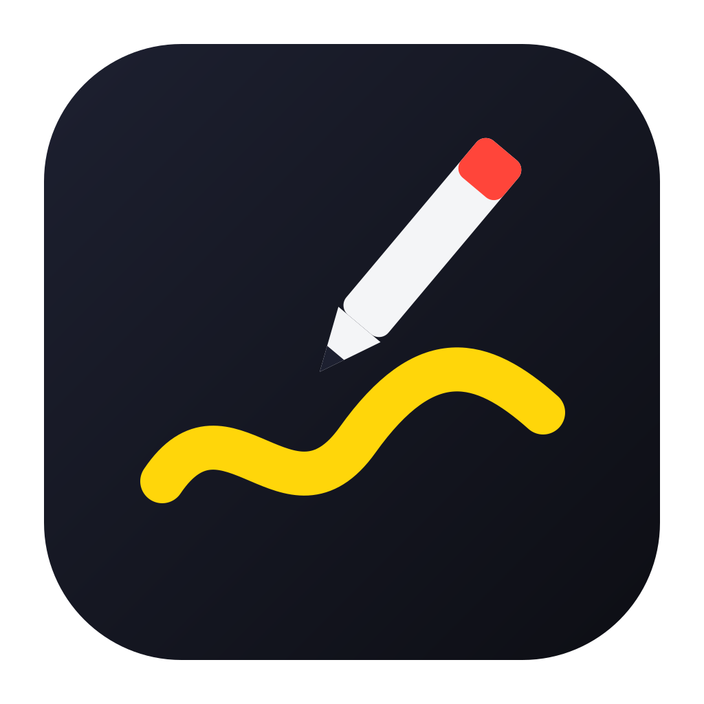

# ratelpen

English · [한국어](README.ko.md)

[](https://github.com/likeratel/ratelpen/actions/workflows/verify.yml)



ratelpen lets you draw on top of your screen while you present, share your screen, or record. Press one shortcut, mark up whatever is on screen with a pen, shapes, arrows and text, and press it again to get your screen back. It lives in the menu bar (system tray on Windows), keeps nothing on disk unless you ask for a screenshot, and never uses the network. Built with Tauri 2, React, TypeScript, and Rust.

> Built with AI. I set the direction and tried the app on my own Mac; the code, tests and docs were written in sessions with [Claude Code](https://claude.com/claude-code).

> **Verification status.** Checked by hand on one Mac (Apple Silicon, single display): draw mode, the pen, rectangle and arrow tools, clearing, and returning focus to the previous app. Everything else is covered by unit and browser tests only. Windows has never been run; see [Limits](#limits).

## Quick start

1. Start ratelpen. A pen icon appears in the menu bar; there is no Dock icon.
2. Press **Option+Tab** (**Alt+Shift+D** on Windows) to turn draw mode on. A toolbar appears at the bottom of the screen.
3. Draw. Pick tools and colours from the toolbar or with the keys below.
4. Press **Option+Tab** or **Esc** to leave draw mode. Your drawing is cleared and clicks go to your apps again.

The menu bar icon offers the same actions: Draw, Clear All, Spotlight, Settings…, Quit.

## Shortcuts

### Anywhere (global)

These work in any app and can be changed in Settings.

| Action | macOS | Windows |
| --- | --- | --- |
| Turn draw mode on or off | `Option+Tab` | `Alt+Shift+D` |
| Clear every screen | `Option+Shift+C` | `Alt+Shift+C` |
| Turn the cursor spotlight on or off | `Option+Shift+S` | `Alt+Shift+S` |

### While drawing

These work only in draw mode and are fixed.

| Key | Action |
| --- | --- |
| `P` | Pen |
| `H` | Highlighter |
| `L` | Line |
| `A` | Arrow |
| `R` | Rectangle |
| `O` | Ellipse |
| `T` | Text |
| `E` | Eraser (removes whole shapes it touches) |
| `1` – `8` | Pick a palette colour |
| `[` / `]` | Thinner / thicker |
| `F` | Fading ink on or off |
| `S` | Cursor spotlight on or off |
| `B` | Cycle the board: none → whiteboard → blackboard |
| `Cmd+Z` / `Ctrl+Z` | Undo |
| `Shift+Cmd+Z` / `Shift+Ctrl+Z` | Redo |
| hold `Space` + click | Select a shape (`Shift` adds or removes one) |
| hold `Space` + drag a shape | Move the selection |
| hold `Space` + drag on empty space | Select everything the rectangle touches |
| `D` | Delete the selection |
| `Delete` / `Backspace` | Delete the selection, or clear this screen when nothing is selected |
| `Esc` | Drop the selection, or leave draw mode when nothing is selected |
| hold `Shift` while dragging | Snap lines to 45° steps; draw squares and circles |

Letter keys work the same with a Korean or other non-Latin input source selected.

## Tools and features

- **Pen and highlighter.** The pen follows pressure from a pen tablet; the highlighter is wide and see-through.
- **Shapes.** Line, arrow, rectangle, ellipse.
- **Text.** Click where the text should go and type. `Enter` places it, `Shift+Enter` starts a new line, `Esc` cancels.
- **Select, move, delete.** Hold `Space` and click a stroke, shape or text to select it; a dashed frame marks it. Keep `Space` held and drag to move it, then press `D` to delete it. Moving and deleting are each one undo step.
- **Fading ink.** With `F` on, new ink disappears by itself after a few seconds (5 by default), which suits pointing at things as you talk.
- **Cursor spotlight.** A halo around the cursor, or a dimmed screen with a bright circle. It keeps working when draw mode is off.
- **Boards.** Cover the screen with a whiteboard or blackboard to sketch on.
- **Screenshots.** The two camera buttons on the toolbar save the screen with your drawing to `Pictures/ratelpen`, or copy it to the clipboard. macOS asks for the Screen Recording permission the first time.
- **Several displays.** Each display gets its own drawing. Undo and `Delete` act on the display that has keyboard focus.
- **Toolbar.** Drag it by the grip on its left edge.

## Settings

Open **Settings…** from the menu bar icon or the gear on the toolbar.

- Global shortcuts: click a field and press the new combination. The ✕ button turns a shortcut off.
- The eight palette colours, the default colour and width.
- How long fading ink stays, and whether it is on by default.
- Spotlight style and size.
- **Clear drawings when leaving draw mode** (on by default). Turn it off to keep your drawing on screen, click-through, after you leave draw mode.
- Launch at login.

## Install

No installer is published yet. Build it from source:

```sh
pnpm install --frozen-lockfile
pnpm tauri build
```

The app is written to `src-tauri/target/release/bundle/`. Requires macOS 12 or later; a locally built app is not notarized.

## Privacy

- ratelpen makes no network requests.
- Drawings exist only in memory.
- The screen is captured only when you press a screenshot button, and the image goes only to `Pictures/ratelpen` or the clipboard. Clipboard managers and clipboard syncing can carry a copied screenshot further.
- Settings are stored in `settings.json` in the app's configuration folder.

## Limits

- **Windows is experimental.** The code is written to build on Windows and CI builds it, but nobody has run it there yet. Focus hand-back, click-through and screenshots are unverified on Windows. `Alt+Tab` cannot be used as a shortcut on Windows.
- Not verified on real hardware: several displays with different scaling, drawing over full-screen apps, pressure from a tablet, and the Screen Recording permission prompt in a signed build.
- A trackpad's pressure is not available to the app; pressure works only with devices that report it to the web view.
- A shortcut that another app already owns may be refused; Settings then marks it and asks for a different one. On macOS some conflicts cannot be detected.
- While you record a new shortcut in Settings, your existing global shortcuts still fire. To swap two of them, clear one, save, then set the other.
- A display added or removed while draw mode is on is picked up the next time draw mode is turned on.
- The toolbar position is not remembered between launches.
- Linux is not supported.

## Development

Prerequisites: Node.js 22, pnpm 10, and a current stable Rust toolchain.

```sh
pnpm install --frozen-lockfile
pnpm tauri dev
```

`pnpm dev` alone opens the UI in a browser against an in-memory stand-in for the core (`http://localhost:1420/?view=overlay` and `?view=settings`), which is what the browser tests use.

### Checks

```sh
pnpm check
pnpm test
pnpm exec playwright install chromium
pnpm test:e2e
pnpm build
pnpm format:check
cd src-tauri
cargo fmt --check
cargo test
cargo clippy --all-targets -- -D warnings
```

The UI and the Rust core talk only through the commands and events in [CONTRACT.md](CONTRACT.md). See [CONTRIBUTING.md](CONTRIBUTING.md) before opening a pull request.

## License

[MIT](LICENSE)
